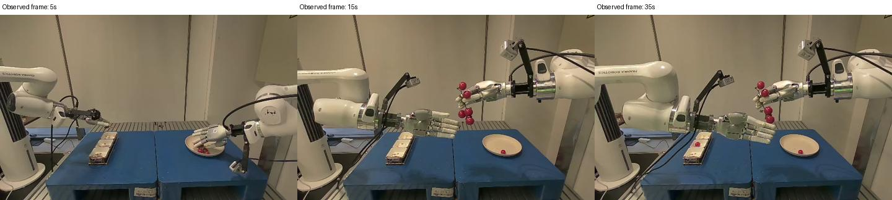
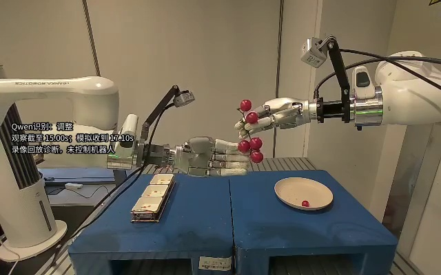

# 当前粗阶段LoRA的因果前缀回放诊断

日期：2026-11-23。结论：当前完整视频LoRA不能直接作为在线阶段识别器使用。

固定使用新增B/1120_1269_1273_normal/episode_000001（81.27秒），每5秒给截至该时刻的完整前缀，另加全长终点，共17次。所有实际输入均被物理截断，不含未来视频帧，也不提供整段预测、参考边界或机器人后续动作。保留相同LoRA，提示词补充“只标已发生阶段，不补齐未来阶段”；这是任务迁移探测，不是已经训练过的在线模型验收。

## 原始结果

| 可见视频截至 | 输出末段类别 | 解码/预处理及生成耗时 |
| ---: | --- | ---: |
| 5.00s | 放回 | 2.86s |
| 10.00s | 采摘 | 1.34s |
| 15.00s | 调整 | 2.10s |
| 20.00s | 采摘 | 2.92s |
| 25.00s | 调整 | 2.66s |
| 30.00s | 调整 | 2.57s |
| 35.00s | 放回 | 3.73s |
| 40.00s | 放回 | 3.97s |
| 45.00s | 放回 | 4.40s |
| 50.00s | 调整 | 3.52s |
| 55.00s | 采摘 | 3.82s |
| 60.00s | 放回 | 4.52s |
| 65.00s | 放回 | 4.36s |
| 70.00s | 放回 | 4.45s |
| 75.00s | 放回 | 4.63s |
| 80.00s | 放回 | 4.47s |
| 81.27s | 放回 | 4.43s |

5秒误报放回，15秒误报调整，35秒再次误报放回，前缀输出会随新画面改写此前的阶段。静态原画面抽查与这些报告明显不符；没有新增逐帧标注，因此不提供正式准确率或精确切换延迟。

## 直观回放

本机视频：`runs/causal_coarse_preview_20261123_v1/causal-preview.mp4`。字幕只在模拟收到结果后更新，显示观测截止时间与阶段识别；不是在观测截止时提前显示答案。结果可用时刻按单请求串行队列与实测预处理+生成耗时模拟，不包含模型加载、前缀文件编码、机器人通信或执行延迟。该回放不证明实时部署性能。

原始回答和协议：[机器记录](coarse_prefix_probe_20261123_results.json)。完整输入源信息、日志、17次输出和本轮执行源码快照在本机runs/causal_coarse_preview_20261123_v1。

## 最短的下一步

保留已训练的整段划分模型与结果。在线观察任务应另建实验：从现有train/val粗阶段区间自动生成截至当前时刻的前缀监督，最后阶段允许进行中，不拼凑未来五阶段；先验证当前阶段识别与稳定性，不加入计数或自动控制。按原完整录像划分数据，前缀之间不跨训练/验证集。已看过的测试和5条新样本不回流这次训练，也不再冒充全新盲测证据。

在线当前阶段识别通过后，仍需分别验证“当前技能完成、允许交接”的条件和执行器握手；观测下一阶段已开始，不等于能在开始之前主动选择下一Prompt。本轮没有启动新训练，也没有接机器人。
