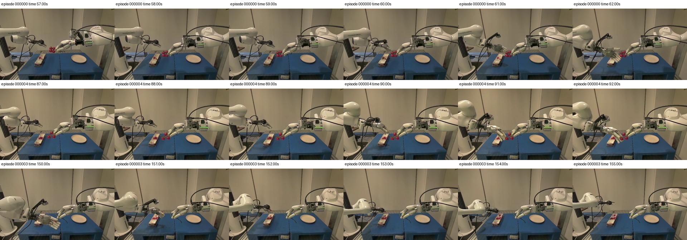
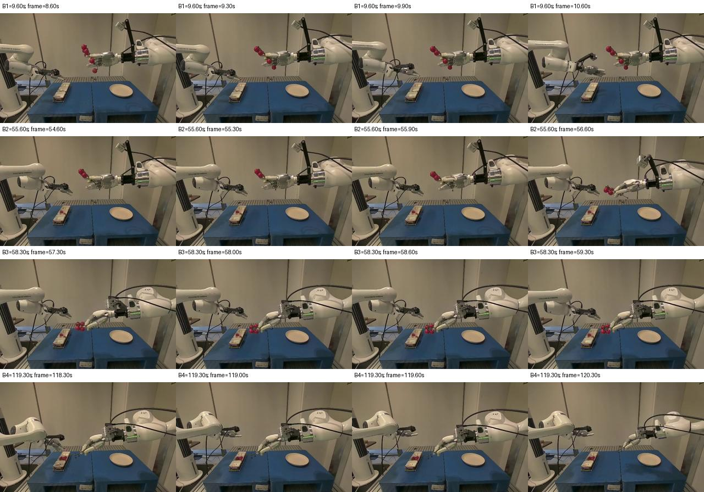
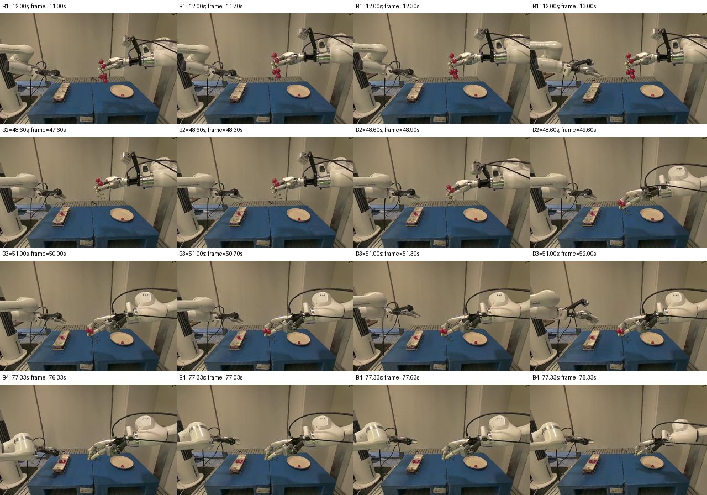
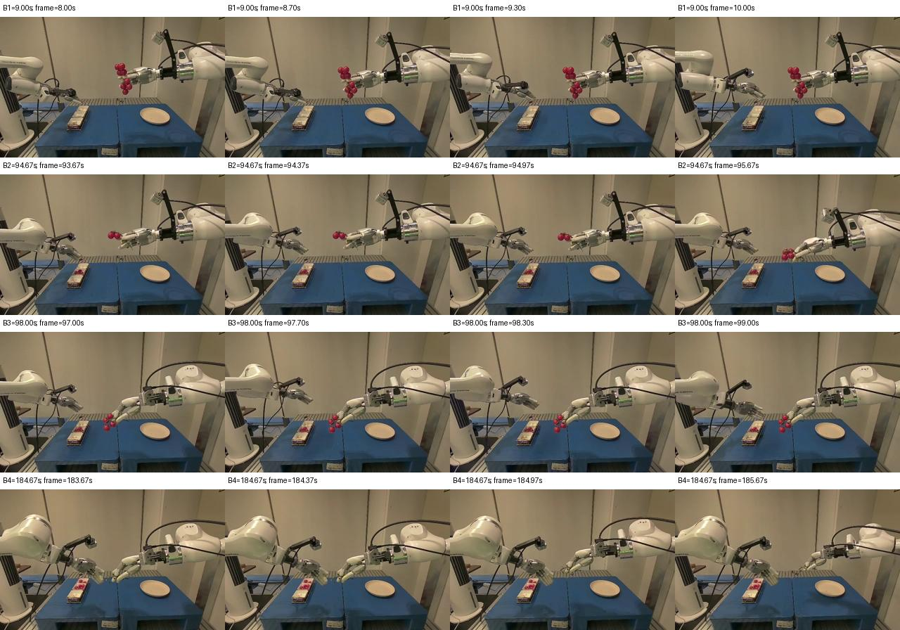
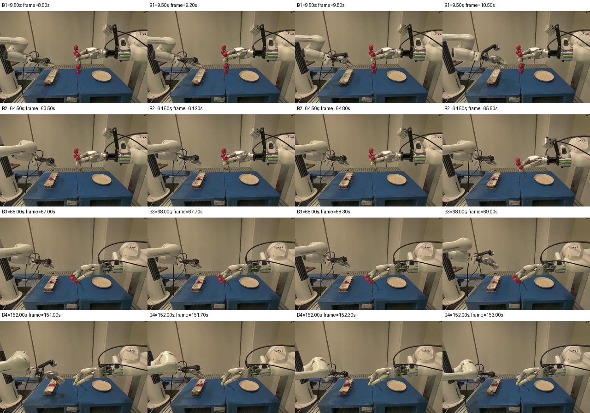
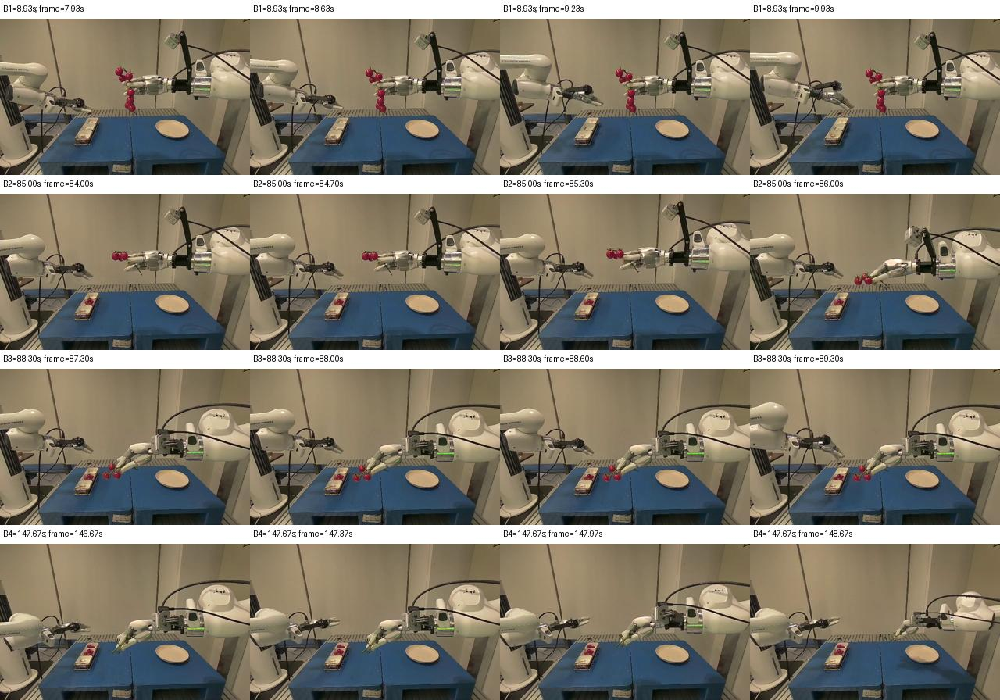

# 28号机器新原始录像：首次粗阶段推理

日期：2026-11-23。远端目录 `/mnt/data/train_platform/datasets/tomato_sharpa/normal/full-block-more`。

## 数据发现

原始A/B包中共209条录像。以source_recording_id对照既有204条，找到5条新增，全部位于`B/1120_1269_1273_normal`，episode_000000至000004。远端subtask-roi、subtask-foveavla-v1、subtask-foveavla-v1-h15下均没有该包；这里的“未处理”限定为本项目既有204条及这些已知处理目录，不声称检查了所有其他项目。

已下载5条原始头部cam0视频及源元数据。全部本地SHA与远端一致，且与原204条头部视频SHA无重叠。没有修改远端数据或训练集。

## 模型原始预测

使用固定Qwen3-VL-4B-Instruct + epoch3 best LoRA，同一训练提示词、原生视频2fps内部采样、贪心生成、512新token预算。每条输入完整头部视频及总时长，无参考标签、无腕部视角、无局部裁剪、无计数。

5/5输出通过JSON、允许标签、区间连续与总时长覆盖检查；五段是模型实际输出，当前校验器不强制新录像必须为五段。没有参考标注，不能计算误差或准确率，也没有将结果自动变成训练真值。

| episode | 时长 | 拿起→采摘 | 采摘→调整 | 调整→再采摘 | 采摘→放回 |
| --- | ---: | ---: | ---: | ---: | ---: |
| 000000 | 124.13s | 9.60s | 55.60s | 58.30s | 119.30s |
| 000001 | 81.27s | 12.00s | 48.60s | 51.00s | 77.33s |
| 000002 | 189.97s | 9.00s | 94.67s | 98.00s | 184.67s |
| 000003 | 159.97s | 9.50s | 64.50s | 68.00s | 152.00s |
| 000004 | 154.27s | 8.93s | 85.00s | 88.30s | 147.67s |

## 原始画面抽查发现

抽查了全部20处预测边界前后约1秒的原始头部画面，并对疑点扩展到更宽时间窗。此步骤是静态画面初查，不是完整视频逐帧标注，不提供精确参考边界。

- episode_000000的调整→再采摘预测58.30秒：58至59秒采摘手仍在盘侧，60秒已经出现回程位移，提示预测可能偏早，需局部视频复核。
- episode_000003的采摘→放回预测152.00秒：153至154秒持串手仍接近原位，155秒出现明显回程变化，提示预测可能偏早数秒。
- 其余边界抽查不能视为确认全部正确；释放、静止和运动起点仍需连续画面核查。

## 每条完整区间与视频

### episode_000000

录像ID：`c7839e0f961b4310a42c86b53226f932`。

[本地原始头部视频](/home/user/datasets/tomato_new_1120_20261123/B/1120_1269_1273_normal/videos/chunk-000/observation.images.cam0/episode_000000.mp4)

拿起 [0.00, 9.60) → 采摘 [9.60, 55.60) → 调整 [55.60, 58.30) → 采摘 [58.30, 119.30) → 放回 [119.30, 124.13)。末段包含视频终点。

### episode_000001

录像ID：`67f911991c9140389621e7c9db6f05e2`。

[本地原始头部视频](/home/user/datasets/tomato_new_1120_20261123/B/1120_1269_1273_normal/videos/chunk-000/observation.images.cam0/episode_000001.mp4)

拿起 [0.00, 12.00) → 采摘 [12.00, 48.60) → 调整 [48.60, 51.00) → 采摘 [51.00, 77.33) → 放回 [77.33, 81.27)。末段包含视频终点。

### episode_000002

录像ID：`785ea788202549859e43311ebd1f5baf`。

[本地原始头部视频](/home/user/datasets/tomato_new_1120_20261123/B/1120_1269_1273_normal/videos/chunk-000/observation.images.cam0/episode_000002.mp4)

拿起 [0.00, 9.00) → 采摘 [9.00, 94.67) → 调整 [94.67, 98.00) → 采摘 [98.00, 184.67) → 放回 [184.67, 189.97)。末段包含视频终点。

### episode_000003

录像ID：`b35e3f53c9ca474999058d737f1ef72f`。

[本地原始头部视频](/home/user/datasets/tomato_new_1120_20261123/B/1120_1269_1273_normal/videos/chunk-000/observation.images.cam0/episode_000003.mp4)

拿起 [0.00, 9.50) → 采摘 [9.50, 64.50) → 调整 [64.50, 68.00) → 采摘 [68.00, 152.00) → 放回 [152.00, 159.97)。末段包含视频终点。

### episode_000004

录像ID：`ac11e95c5e6a4d71ab59cbb91b060694`。

[本地原始头部视频](/home/user/datasets/tomato_new_1120_20261123/B/1120_1269_1273_normal/videos/chunk-000/observation.images.cam0/episode_000004.mp4)

拿起 [0.00, 8.93) → 采摘 [8.93, 85.00) → 调整 [85.00, 88.30) → 采摘 [88.30, 147.67) → 放回 [147.67, 154.27)。末段包含视频终点。

## 产物与下一步

[机器可读的原始预测、哈希和复核备注](new_raw_20261123_results.json)。本机完整发现/推理日志在`runs/new_raw_probe_20261123_v1`，视频位于`/home/user/datasets/tomato_new_1120_20261123`。

本次说明模型能对未参与训练的新录像生成完整粗阶段区间，同时暴露出等待与下一阶段运动起点可能混淆的问题。5条保留为新增评估样本，不回流训练；若以后以这些结果迭代模型，应另留未见数据做最终评估。
